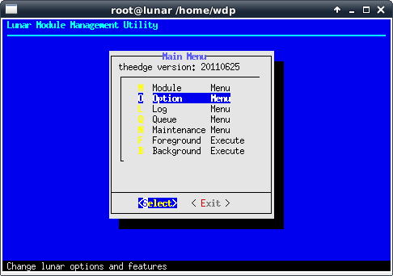
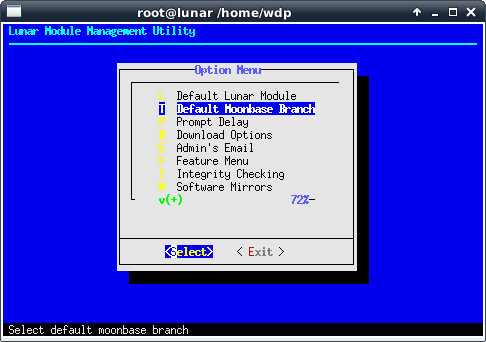
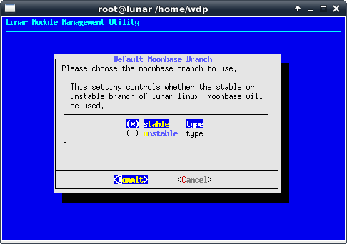

Both, developers and users awaited the ability to have Lunar Linux in stable and unstable. The last few days and in the past months we had talks and discussions about that and today we came to a solution.

Instead of writing a lot of bla bla: Currently you can decide between stable and unstable ONLY if you use theedge - And except you're a developer or know what you're doing you should NOT play around with it, yet. We've started an ongoing process.

We still need to discuss a little bit more on the rules for stable and unstable; However: stable will have older modules (maximum 1month) and will be well tested by developers, where as unstable will contain the latest available stable software (updated frequently) and thus candidates for the stable-branch.

Thanks to all the developers making this possible!

**Step 1** - Everything as usual  
{width="486" height="342"}

**Step 2** - Whoooa. There's a new menu item!  
{width="486" height="342"}

**Step 3** - Cool. mkay?  
{width="486" height="342"}
